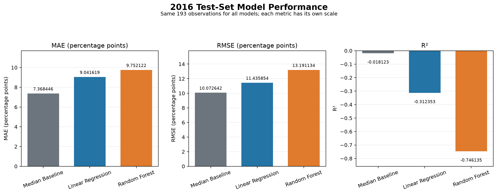
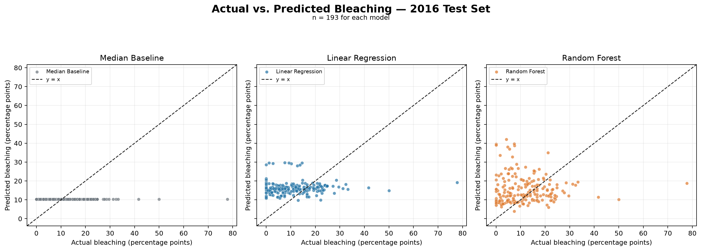
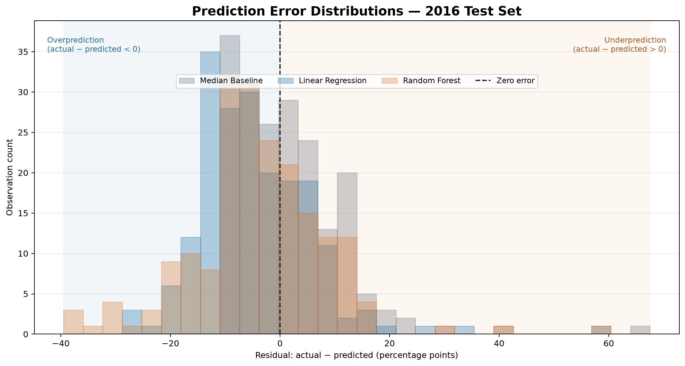
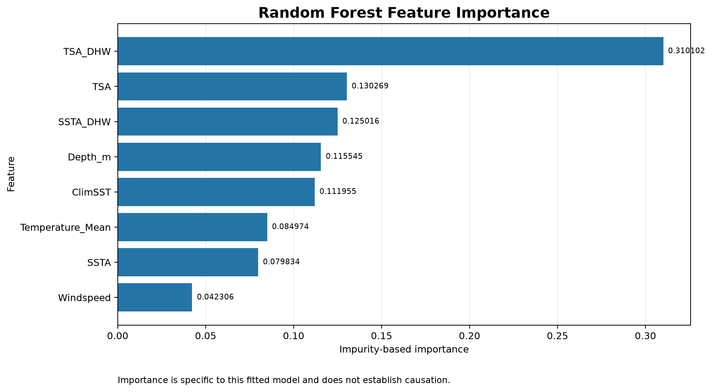
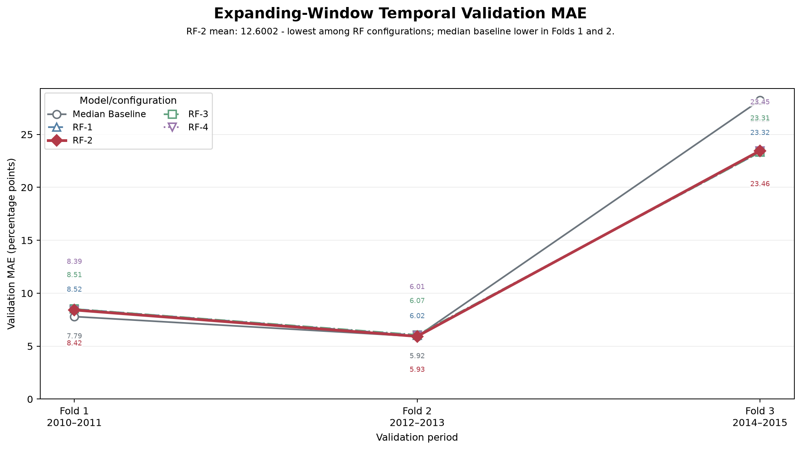

# ReefGuard-ML — Model Evaluation and Visualization

This report describes the saved evaluation outputs and the figures generated by [`src/visualize_evaluation.py`](../src/visualize_evaluation.py). The script reads existing predictions, test data, evaluation reports, feature importance, and time-aware validation results. It does not retrain models or change existing source data or results.

## Scope and alignment

The initial model comparison uses the same 193 observations from the 2016 test set for the median baseline, Linear Regression, and Random Forest. The saved prediction actuals match `test_v1.csv` row-for-row, and split metadata identifies the test observations as 2016. The high-bleaching subgroup contains only six test observations, so group-level conclusions for that range are especially uncertain.

The temporal validation results are a separate analysis: three expanding-window folds using 2005–2015 training data. They are not 2016 test metrics. RF-2 was evaluated only in those temporal validation folds; no RF-2 2016 test result is presented here. The 2016 results have been examined in prior reports, so this test set should not be described as a pristine, untouched final holdout.

## 1. Model performance comparison



**What it shows and how to read it.** Three panels compare MAE, RMSE, and R² for the initial median baseline, Linear Regression, and Random Forest. Each panel has its own axis because the metrics have different meanings and scales. MAE and RMSE are in bleaching percentage points; smaller values are better. R² is unitless, with larger values generally better. Values are printed on the bars.

**Results.** On the 2016 test set, the median baseline scored MAE **7.368446**, RMSE **10.072642**, and R² **-0.018123**. Linear Regression scored **9.041619**, **11.435854**, and **-0.312353**, respectively. Random Forest scored **9.752122**, **13.191134**, and **-0.746135**, respectively. Thus, the median baseline has the lowest MAE and RMSE and the highest R² of these three initial models.

**Interpretation and limits.** Negative R² values indicate that these predictions scored worse, under the R² definition, than predicting the mean of the observed test targets. They do not measure performance against the training-median baseline; compare MAE/RMSE directly for that. This is a comparison on one 2016 period, not proof of general future performance or a causal result. Bias from the existing comparison report (`mean(actual − predicted)`) was **+1.343886** for the baseline, **−4.702714** for Linear Regression, and **−3.965381** for Random Forest.

## 2. Actual vs. predicted bleaching



**What it shows and how to read it.** Each panel plots observed bleaching against one model's predictions for the 193 test observations. The dashed `y = x` line represents perfect prediction; points closer to it have smaller errors. Both axes are in percentage points. Values are plotted as saved: predictions are not clipped to 0–100.

**Results.** The baseline predicts the training-target median of **10.260000** for every test observation, so its points form a horizontal band. The two ML models vary their predictions, but on aggregate their MAE and RMSE are higher than the baseline (see the exact values above). The error report records only **six** actual test observations above 30% bleaching; the chart should not be read as strong evidence about such high bleaching values.

The existing prediction-error report gives these subgroup MAEs:

| Actual bleaching range | Observations | Median Baseline MAE | Linear Regression MAE | Random Forest MAE |
|---|---:|---:|---:|---:|
| Low (0–10%) | 94 | 6.1827 | 11.9829 | 12.1818 |
| Moderate (>10–30%) | 93 | 6.8391 | 4.8629 | 6.0942 |
| High (>30–100%) | 6 | 34.1500 | 27.7303 | 28.3837 |

**Interpretation and limits.** The line helps reveal systematic departures and large errors, but overlapping observations and the small high-bleaching subgroup limit visual inference in that range. This plot describes the saved predictions; it does not explain why a prediction is high or low or establish behavior outside the observed 2016 test set.

## 3. Prediction error distribution



**What it shows and how to read it.** Residuals are defined as **actual − predicted**. The vertical zero line marks exact predictions. Negative residuals indicate overprediction; positive residuals indicate underprediction. Histograms use a common residual axis, and the lightly shaded sides distinguish those directions.

**Results.** For the 193 test observations, the existing error summary reports:

| Model | Overestimates (negative residual) | Underestimates (positive residual) | Exact |
|---|---:|---:|---:|
| Median Baseline | 96 | 96 | 1 |
| Linear Regression | 137 | 56 | 0 |
| Random Forest | 127 | 66 | 0 |

These counts agree with the reported mean residual/bias: **+1.343886** for the baseline, **−4.702714** for Linear Regression, and **−3.965381** for Random Forest.

**Interpretation and limits.** A concentration to the right corresponds to more underprediction; a concentration to the left corresponds to more overprediction. The counts and distribution describe the direction and spread of errors on these test observations only. They do not imply that the same balance will occur in another period. In particular, large high-bleaching errors involve a subgroup of only six observations.

## 4. Random Forest feature importance



**What it shows and how to read it.** The horizontal bars show the saved Random Forest feature-importance values, ordered from smaller to larger. Longer bars indicate greater impurity-based importance within this fitted model.

**Results.** `TSA_DHW` is largest (**0.310102**), followed by `TSA` (**0.130269**), `SSTA_DHW` (**0.125016**), `Depth_m` (**0.115545**), `ClimSST` (**0.111955**), `Temperature_Mean` (**0.084974**), `SSTA` (**0.079834**), and `Windspeed` (**0.042306**).

**Interpretation and limits.** These scores describe how this fitted Random Forest used its inputs. Impurity-based importance is model-specific and does **not** establish causation or scientific importance. Correlated predictors can affect how importance is distributed, and the chart does not show the direction of a feature's association with bleaching.

## 5. Temporal validation comparison



**What it shows and how to read it.** Lines show saved validation MAE for three expanding-window folds: 2010–2011, 2012–2013, and 2014–2015. Lower MAE is better. The series are the training-fold median baseline and Random Forest configurations RF-1 through RF-4. Distinct line styles and markers, plus point labels, make the close values easier to distinguish; RF-2 is highlighted. This chart uses only the historical validation results; it is not a 2016 test comparison.

**Results.** The fold MAEs (percentage points) and saved aggregate arithmetic means are:

| Model/configuration | Fold 1 (2010–2011) | Fold 2 (2012–2013) | Fold 3 (2014–2015) | Mean validation MAE |
|---|---:|---:|---:|---:|
| Median Baseline — Training-fold median | 7.7939 | 5.9178 | 28.2266 | 13.9795 |
| Random Forest — RF-1 | 8.5196 | 6.0151 | 23.3242 | 12.6196 |
| Random Forest — RF-2 | 8.4173 | 5.9260 | 23.4574 | 12.6002 |
| Random Forest — RF-3 | 8.5125 | 6.0684 | 23.3146 | 12.6318 |
| Random Forest — RF-4 | 8.3904 | 6.0100 | 23.4532 | 12.6179 |

RF-2 has the lowest **mean among the four Random Forest configurations** (12.6002), compared with the fold-median baseline mean of 13.9795. Its mean MAE improvement over the baseline is 1.3792, but the advantage is inconsistent across folds: the baseline is better by **0.6234** in Fold 1 and **0.0082** in Fold 2; RF-2 is better by **4.7692** in Fold 3. Each Random Forest configuration beats the baseline in only one of the three folds. RF-2 did not win every fold.

**Interpretation and limits.** The lower RF mean is driven by the large difference in Fold 3, while the baseline is marginally or clearly better in the first two validation periods. This is a candidate comparison over three historical folds, not proof of stable future performance. The mean is an arithmetic mean of fold MAEs, not a pooled 2016 test metric. No result here establishes how RF-2 would perform on the 2016 test data.

## Reproducibility

From the project root, run:

```bash
python src/visualize_evaluation.py
```

The script validates that saved prediction actuals align with the test file and that split metadata identifies 2016, then writes the five PNG files in `reports/figures/`. It only reads the existing evaluation inputs and writes the requested figures; it does not train models, change predictions, or overwrite the existing CSV results.
